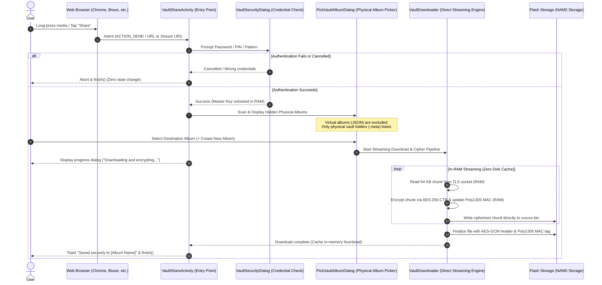

# Fossify Gallery Cipher - Architecture, Cryptography & User Guide

Fossify Gallery Cipher is a privacy-first, security-hardened open-source media gallery for Android. In addition to standard gallery capabilities, it features **hardware-level memory zeroization**, **Argon2id and AES-256 cryptographic vaults**, **zero-storage-footprint virtual albums**, and **advanced video player buffering and frame caching optimizations**.

---

## 1. Storage & On-Disk Architecture (`Internal Storage > Documents > Cipher`)

All specialized data generated by Fossify Gallery Cipher is organized centrally under the device's public `Documents/Cipher` directory. The filesystem hierarchy is structured as follows:

```text
Internal Storage/
└── Documents/
    └── Cipher/
        ├── Virtual Album Saves/
        │   ├── Vacation.json
        │   ├── Favorites.json
        │   └── Roadtrip.json
        │
        └── Cipher_Secrets/
            ├── .nomedia
            ├── .vault
            ├── JSON/
            │   ├── 8f4b1e2a9c3d4e5f.json
            │   └── 3a7d9e1f5b6c8a2e.json
            │
            ├── a1b2c3/ (Encrypted Physical Vault 1)
            │   ├── .nomedia
            │   ├── .meta
            │   ├── 4f8a1c9e2b5d7a3f.bin
            │   └── e9d8c7b6a5f4e3d2.bin
            │
            └── d4e5f6/ (Encrypted Physical Vault 2)
                ├── .nomedia
                ├── .meta
                └── 7c8b9a1e3f5d2c4b.bin
```

### A. `Virtual Album Saves/` (Standard Virtual Albums)
- Contains JSON manifests for virtual albums created from unencrypted, standard physical folders.
- The filename matches the display name of the virtual album (e.g., `Vacation.json`).
- Stores references to original file paths on disk without duplicating data. Adding a photo to any number of virtual albums uses zero additional storage space.

### B. `Cipher_Secrets/` (Cryptographic Vault Container)
Created when the user enables password protection for hidden items in Settings:
- **`.nomedia`:** Instructs Android's `MediaScanner` to ignore this entire directory tree, preventing thumbnails or raw binary streams from leaking to other apps or system providers.
- **`.vault` (Master Vault Header):** Stores the encrypted bundle containing the 256-bit Master Encryption Key (MEK) and RSA-2048 keypair, protected via `Argon2id` (32 MB RAM cost, 3 iterations) and `AES-256-GCM`.
- **`JSON/` (Stealth Encrypted Virtual Albums):**
  - When a virtual album is created from contents of a hidden/encrypted physical album, it automatically gains **Stealth Virtual Album** status.
  - The filename is an obfuscated 16-character hexadecimal identifier (`fva_8f4b1e2a9c3d4e5f.json`), derived via HMAC-SHA256 with MEK.
  - The album title and all member file paths within the JSON payload are encrypted via `AES-256-GCM` with the `FVSTR1:` prefix. Inspecting the file on disk reveals neither the album name nor any media paths.
- **Randomized Vault Subfolders (`a1b2c3/`):**
  - Encrypted physical albums are moved inside `Cipher_Secrets` under randomized subfolder names.
  - Original album names are encrypted and saved in `.meta` via `AES-256-GCM`.
  - All media files are converted to randomized `.bin` files (`<random_hex>.bin`), and original plaintext files are securely shredded.

---

## 2. Cryptographic Specifications & Bit-Rot Resilience

Fossify Gallery Cipher employs a defense-in-depth cryptographic pipeline designed to prevent data leakage, mitigate offline brute-force attacks, and isolate corruption:

| Component | Primitive / Algorithm | Purpose |
| :--- | :--- | :--- |
| **Key Derivation (KDF)** | `Argon2id` (64 MB RAM, 3 iterations, 2 threads) | Hardware-hardened key derivation resistant to GPU/FPGA/ASIC cracking |
| **Hardware Key Protection** | Android Keystore (`AES-256-GCM`, StrongBox / TEE) | Device-bound cryptographic wrapping layer (`vaultWrappedKeyData`) |
| **Vault Headers & Strings** | `AES-256-GCM` (`12-byte IV`, `128-bit Tag`) | Authenticated encryption for headers, thumbnails, and metadata |
| **Payload Streams** | `AES-256-CTR` (`16-byte IV` with counter derivation) | Random-access streaming encryption for images and high-bitrate videos |
| **Integrity Verification** | `Poly1305-AES` MAC (`16-byte Tag`) with AAD Header Binding | Cryptographic tamper detection during export, streaming, and decryption |
| **Pre-Wipe Verification** | SHA-256 Digest Verification + Decryption Readback | Guarantees file is 100% decryptable before original plaintext is touched |
| **Screen & Recents Guard** | `FLAG_SECURE` + Android 13+ Recents Suppression | Prevents screen capture, video recording, and task switcher leakage |
| **Data Destruction** | Full-file CSPRNG overwrite (1 MiB chunks) + `fsync` + `syncDir` | Best-effort shredding subject to flash controller wear-leveling realities |

### Bit-Rot Resilience (Zero Error Propagation)
Monolithic container formats (such as Veracrypt volumes or ZIP archives) risk total catastrophic loss if a single sector corrupts. Fossify Gallery Cipher avoids this through granular file isolation:
1. **File-Level Granularity:** Each image and video is stored as an independent encrypted binary file. Corruption in one file has **zero effect** on any other file or the vault at large.
2. **CTR Mode Error Isolation:** `AES-256-CTR` operates as a stream cipher (`Ciphertext = Plaintext ⊕ Keystream`). A 1-bit corruption in ciphertext affects **only that exact single bit** upon decryption. Adjacent bytes and the rest of the file remain intact. In JPEG photos, bit-rot results only in a minor visual artifact rather than complete decode failure; in MP4 videos, only a single corrupted microsecond frame occurs while the rest of the stream continues playing.
3. **Hardware-Bound & Redundant Keying:** Vault credentials on disk (`.vault`) are backed by an Android Keystore hardware-bound wrapping layer (`vaultWrappedKeyData`) with StrongBox / TEE enforcement. If the master header file suffers physical sector loss, the application can recover the master key bundle on the authenticated device.

---

## 3. Application Operating Modes (Mode 1, Mode 2, Mode 3)

The application transitions through three distinct operational states to balance convenience and privacy:

```
                  ┌────────────────────────────────────────┐
                  │          MODE 1: Standard Mode         │
                  │   (Normal Albums, Vaults Locked)       │
                  └───────────────────┬────────────────────┘
                                      │ Enter Password /
                                      │ 3x Bottom Scroll
                                      ▼
                  ┌────────────────────────────────────────┐
                  │          MODE 2: Secret Vault          │
                  │  (Isolated View: Encrypted Physical    │
                  │     & Stealth Virtual Albums Only)     │
                  └───────────────┬────────▲───────────────┘
                                  │        │ 3x Bottom
                     Back Key ◄───┘        │ Scroll Gesture
                                           │
                                           ▼
                  ┌────────────────────────────────────────┐
                  │          MODE 3: Extended View         │
                  │  (Unified Grid: Standard Albums +      │
                  │    .nomedia Folders + Vault Folders)   │
                  └───────────────────┬────────────────────┘
                                      │ Swipe-kill App /
                                      │ "Stop showing hidden"
                                      ▼
                  ┌────────────────────────────────────────┐
                  │           MEMORY ZEROIZATION           │
                  │ (RAM fill(0), Clear Bitmaps & Caches)  │
                  └────────────────────────────────────────┘
```

### 🔹 Mode 1: Standard / Locked Mode (Default)
- The state upon cold app startup when credentials have not been entered.
- System `.nomedia` directories (e.g., WhatsApp Stickers, app thumbnails) and encrypted vault folders under `Cipher_Secrets` are **completely hidden**.
- Only unencrypted physical albums and standard virtual albums appear in the gallery grid.

### 🔹 Mode 2: Secret Vault Mode
- Activated by entering the vault password in Settings or performing a **3x bottom overscroll gesture** at the bottom of the main gallery list.
- **Isolated Vault View:** Standard photos and normal albums are completely filtered out. The user is presented with a dedicated vault screen containing **only encrypted physical albums and stealth virtual albums**.
- Action bars update to indicate active Secret Vault mode.

### 🔹 Mode 3: Extended / Unified View Mode
- Activated when the user presses the **Android Back button** while inside Mode 2 (Secret Vault).
- The user returns to the primary gallery grid; however, normal albums, system `.nomedia` folders, and decrypted vault albums are displayed **together in a single unified view**.
- Performing the **3x bottom overscroll gesture** while in Mode 3 instantly transitions the user back into the isolated **Mode 2 (Secret Vault)**.

### 🛑 Lock & Memory Zeroization (RAM Purge)
- When the user closes the app (swiping away from Android's Recents overview) or taps *"Stop showing hidden items"*:
  - The app locks immediately and returns to Mode 1.
  - In-memory Master Keys, Private Keys, and cached file keys are zeroized (`fill(0)`).
  - Glide memory and disk caches are wiped to ensure decrypted frames do not persist in flash storage.

---

## 4. Virtual Album Rules & Strict Single Physical Album Binding

1. **Strict 1-to-1 Physical Ownership:**
   - A virtual album can only contain items that originate from a **single physical album**.
   - When copying media from a physical album, the directory picker only displays virtual albums that belong to that specific physical folder. Media from disparate folders cannot be mixed into the same virtual album.
2. **"Move" Action Disabled:**
   - Because virtual albums only reference media without altering disk locations, the "Move" action is removed from virtual albums; only non-destructive "Copy" operations are permitted.
3. **Copy Flows from Virtual Albums:**
   - Copying media from within a virtual album suggests sibling virtual albums linked to the same parent physical album.
   - Media cannot be copied from a virtual album to its own owning physical album (the media already exists there).
   - Creating a new virtual album during a copy flow automatically binds the new album to the source physical owner.

---

## 5. Device Migration, Backup & Vault Auto-Detection

- **Portability:** To migrate vaults to a new phone or restore after a factory reset, simply copy the `Documents/Cipher` folder into the new device's `Documents/Cipher` directory.
- **Auto-Discovery:** When opening the gallery on the new phone and toggling "Protect hidden item visibility with password", the app automatically scans and detects the existing vault.
- **Decision Flow:**
  - The dialog prompts: *"Do you want to access your existing Cipher_Secrets folder?"*
  - **YES:** No new password is created; the user is prompted for the existing vault's password, and all media is unlocked immediately.
  - **NO (Destructive Reset Protection):** If the user chooses to delete the existing vault and create a new one:
    - A mandatory 10-second countdown runs before confirmation is enabled.
    - An explicit "I confirm" checkbox must be ticked after the countdown.
    - The "Yes" confirmation button is positioned on the left (inverted) to prevent accidental muscle-memory taps.

---

## 6. Video Player Architecture, Gestures & Playback Optimizations

- **Instant Resume (`sVideoFrameCache`):** When pausing or swiping away from a video, the current hardware `TextureView` frame is captured into an in-memory LRU cache. Swiping back from any distance (3+, 5, 10+ items) displays the exact paused frame immediately instead of falling back to the 00:00 cover photo.
- **Pre-Warming:** Adjacent fragments with stored session playback positions initialize and seek ExoPlayer in the background before the page settles, eliminating buffering delays upon centering.
- **Configurable Double-Tap Seek Duration:**
  - Users can customize the double-tap forward and rewind jump duration under **Settings > Videos > Double-tap seek duration** (`3`, `5`, `10`, or `15` seconds).
  - The default seek duration is set to **5 seconds** (previously hardcoded to 10 seconds).
  - This configuration applies consistently to double-tap seeking on both sides of the screen, tap-to-skip on the current time and duration labels, and side scroll controller actions across both the in-app pager player (`VideoFragment`) and standalone player (`VideoPlayerActivity`).
- **Interactive Control Bar & Auto-Hide:**
  - The playback bar features a dedicated playback speed selector button (top-left) and audio mute/unmute toggle (top-right).
  - Tapping the video to focus or waiting for the playback timeout automatically fades out the entire control bar (including speed and mute buttons); single-tapping again smoothly restores all controls together.
- **Natural Swipe-Down to Dismiss:**
  - Swiping down from top to bottom when viewing media at original size (unzoomed 1:1 scale) dismisses the viewer and returns to the album grid view, mirroring the back button.
  - The gesture discriminator cleanly isolates intentional downward pulls from horizontal page swipes, using density-aware thresholds (40dp) and natural gesture duration (up to 500ms).
  - When content is zoomed in—via 2-finger pinch in videos or photos, or double-tap in photos—downward swipe dismiss is automatically disabled to allow free panning.

---

## 7. Zero-Disk Streaming Vault Downloader (Direct-to-Ciphertext)

When downloading media using traditional mobile browsers, files are saved as plaintext into the public download directory (`/storage/emulated/0/Download`) before any application can move or encrypt them. This workflow introduces severe anti-forensic vulnerabilities:

1. **Flash Storage Data Remanence:** NAND Flash controllers (UFS and eMMC) utilize a Flash Translation Layer (FTL) with wear-leveling algorithms. Even if a file is wiped or shredded after encryption, physical flash blocks containing plaintext chunks remain un-erased until long-term TRIM and garbage collection cycles occur.
2. **System MediaStore Leakage:** As soon as a file touches disk, Android's `MediaScanner` indexes its name and metadata into `external.db` and often generates plaintext system thumbnails in `.thumbnails`.

Fossify Gallery Cipher solves this with a **Zero-Disk Streaming Downloader**: incoming network bytes are held strictly in a transient RAM buffer, piped through an authenticated stream cipher, and committed directly to flash memory as randomized `.bin` ciphertext. Plaintext never touches non-volatile storage.

### A. Architectural Sequence Diagram



### B. Core Architectural Components

#### 1. Entry Point (`VaultShareActivity`)
- Registered in `AndroidManifest.xml` with intent filters for `android.intent.action.SEND` and `android.intent.action.SEND_MULTIPLE` supporting `text/plain` (web links), `image/*`, and `video/*`.
- Configured with `@style/TranslucentTheme` and `android:excludeFromRecents="true"` to prevent lingering previews in Android's task switcher.
- Extracts URLs from `Intent.EXTRA_TEXT` (via regex) or direct streams from `Intent.EXTRA_STREAM` (content/file URIs).

#### 2. Mandatory Pre-Action Authentication (`VaultSecurityDialog`)
- Before displaying any vault contents, album names, or folder structures, the user must authenticate using their configured credential (PIN, Password, or Pattern).
- If authentication fails or is dismissed, the activity immediately exits (`finish()`), revealing zero information about the vault structure.
- Upon successful authentication, the 256-bit Master Encryption Key (MEK) is unlocked in volatile RAM (`CryptoManager.unlockedMasterKey`).

#### 3. Strict Physical Album Isolation (`PickVaultAlbumDialog`)
- **Exclusion of Virtual Albums:** Scans subdirectories in `CryptoManager.getOrCreateVaultRoot(context)`. Any non-media subfolders—specifically `JSON/` where virtual album manifests reside—are strictly omitted.
- **On-the-Fly Name Decryption:** Vault directories exist on disk under randomized hexadecimal names (e.g., `vault/e8f2a1/`). Using the unlocked MEK, each folder's `.meta` header is decrypted in memory to display the human-readable album title (e.g., *"Private Documents"* or *"Vacation"*), alongside the count of `.bin` files inside.
- **Instant Album Creation:** Users can tap **"+ Create New Hidden Album"**, which generates a new randomized subfolder on disk, creates a `.nomedia` file, encrypts the title into `.meta`, and automatically targets it for download.

#### 4. Direct Streaming Encryption Pipeline (`CryptoManager.encryptStreamToDirectory`)
- **Zero Disk Cache:** `VaultDownloader` disables HTTP caches (`useCaches = false`, `defaultUseCaches = false`, `Cache-Control: no-store`) and follows HTTP 301..308 redirects automatically.
- **In-Memory Streaming:** Data is read in 64 KB chunks from the network input stream directly into memory.
- **Stream Ciphering:** Chunks are passed into `AES-256-CTR` and incrementally authenticated using `Poly1305`. Ciphertext bytes are flushed directly into `targetDir/<random_hex>.bin`.
- **Deterministic Header Sizing:** If the server provides a `Content-Length`, the header is written upfront. If the transfer is chunked or size is unknown, the header is updated after EOF using `RandomAccessFile` seek operations, taking advantage of fixed-size AES-GCM ciphertext blocks.
- **In-RAM Thumbnail Extraction:** For image downloads, image dimensions and sample sizes are calculated by decoding stream bounds directly in memory from `openDecryptedContentStream()`, without writing intermediate unencrypted preview files to disk. Thumbnail bytes are compressed to JPEG and cached strictly in `CryptoManager.metadataCache`.

